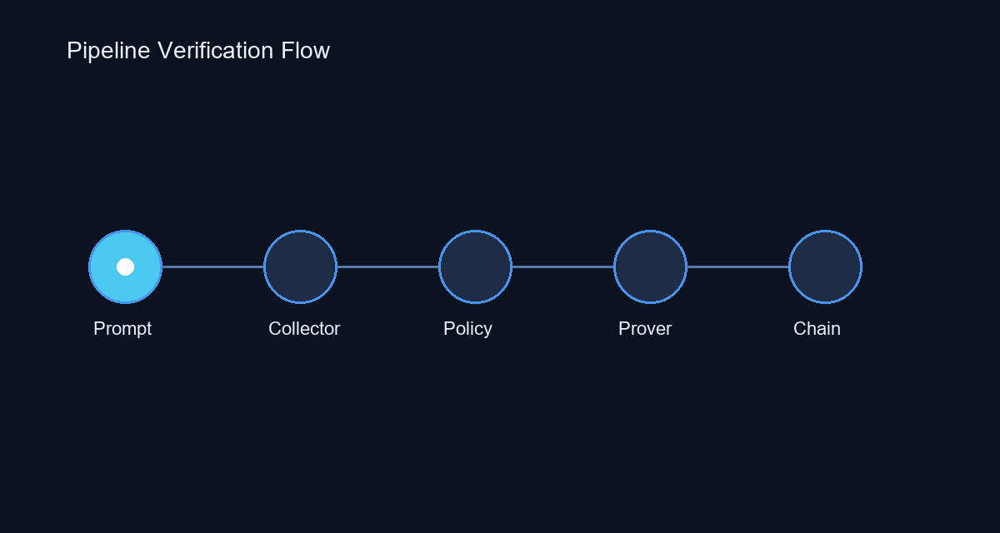
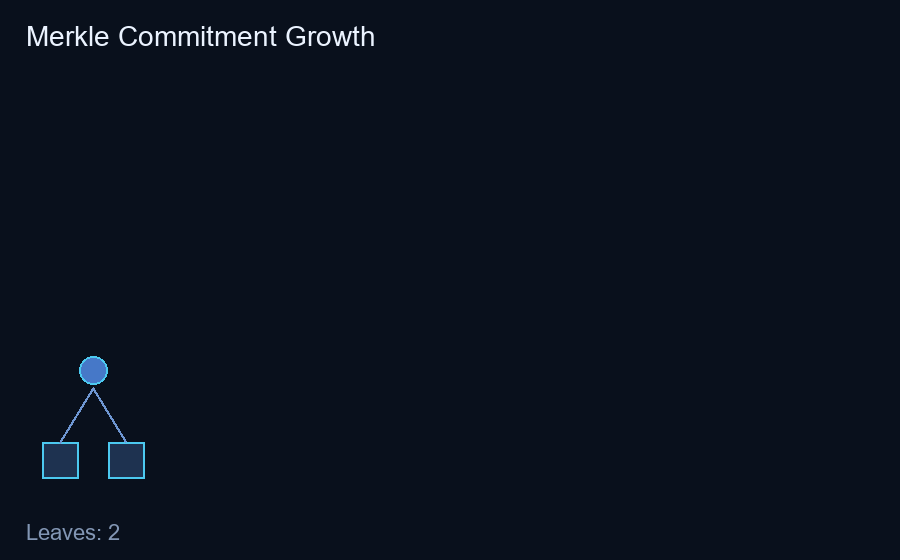
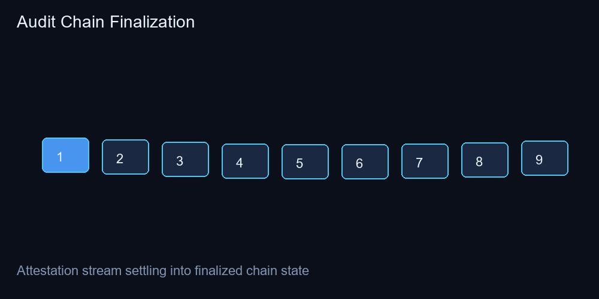
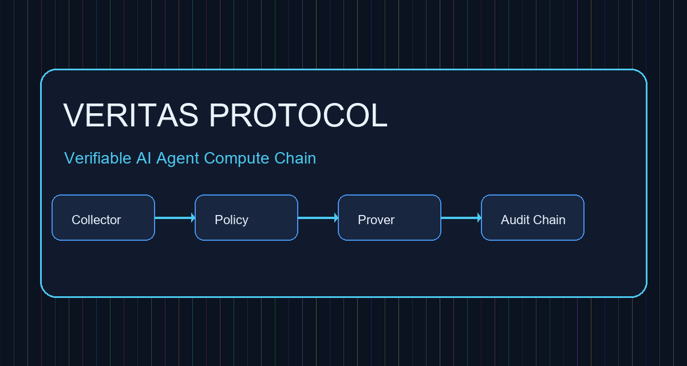
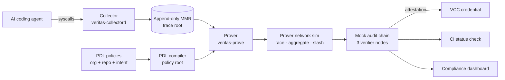

<div align="center">



# 🔏 Veritas Protocol

### A self-sovereign, verifiable compute audit chain for agentic AI code generation

 

[](LICENSE)    

[](https://codespaces.new/shiroonigami23-ui/veritas-protocol-ai-agents?quickstart=1) [](https://github.com/shiroonigami23-ui/veritas-protocol-ai-agents/archive/refs/heads/main.zip)

[**Overview**](#-overview) · [**Features**](#-features) · [**Architecture**](#-architecture) · [**Getting Started**](#-getting-started) · [**Roadmap**](#-roadmap)

</div>

---

## 📸 Preview

<p align="center">
  
  
  
</p>

## 📖 Overview

When an AI coding agent writes files and runs processes on your machine, how do you **prove** afterwards exactly what it
did — and that it stayed inside policy? **Veritas** answers that with a verifiable audit chain:

1. a **collector** records the agent's syscall-level activity as a canonical, append-only trace (Merkle Mountain Range);
2. a **policy language (PDL)** compiles organisational rules into deterministic constraints;
3. a **prover** checks the trace against the policy and emits a proof artefact;
4. a **mock audit chain** of verifier nodes attests and anchors the proof;
5. **Verifiable Compliance Credentials (VCCs)** let you disclose selected facts offline, and CI/dashboards consume the result.

The repository implements the blueprint (`Blueprint.pdf`, May 2026) through **Iterations 0–3** as a Python reference prototype,
with every functional requirement traced to code and tests.

### ✨ Highlights

- **9 CLI tools** — prove, verify, collect, policy dry-run, prover-network sim, VCC build/verify, CI status, dashboard
- **Requirement traceability** — `FR-POL-*`, `FR-COLL-*`, `FR-PROV-*`, `FR-CHAIN-*` mapped to modules and tests
- **Streaming MMR** with `append`, `get_proof`, `finalize` and intent-based write de-duplication
- **Prover-network simulation** — proof-race mempool, recursive aggregation, cut-and-choose slashing
- **Iteration-0 exit gate** — 3 file writes + 2 process execs proven and anchored in under 120 s

## 🧩 Features

| Feature | What it does |
|---|---|
| **veritas-prove** | Trace + policy → proof artefact; optional `--anchor` to the 3-node mock chain |
| **veritas-verify** | Independently re-verifies a proof bundle |
| **veritas-collectord** | Sidecar-style collector: canonical syscall events, write-intent dedup, MMR commitments |
| **Policy Definition Language** | PDL parser/compiler → deterministic constraints + policy root (`FR-POL-1`) |
| **veritas-policy-dryrun** | Compose org + repo + intent policies and dry-run them against recorded traces (`FR-POL-2/3`) |
| **veritas-provernet-sim** | Distributed prover race, recursive aggregation, slashing (`FR-PROV-1/2/3`) |
| **veritas-vcc-build / verify** | Selective-disclosure compliance credentials with offline verification (`FR-CHAIN-3`) |
| **veritas-ci-status** | Generates a PR status-check artefact from a proof |
| **veritas-dashboard-snapshot** | Compliance dashboard snapshot JSON |

## 🛠 Tech Stack

| Layer | Technology |
|---|---|
| Language | Python ≥ 3.11 (setuptools package `veritas-protocol`) |
| Crypto primitives | Hash commitments, Merkle Mountain Range, Merkle proofs |
| Testing | `unittest` suite (prover, collector CVT, PDL, policy engine, prover network, VCC, CI, dashboard) |
| CI | GitHub Actions |
| Docs | Blueprint PDF, architecture & testing notes in `docs/` |

## 🏗 Architecture

Five layers — collect, commit, constrain, prove, attest — each a separate package under `src/veritas/`.



➡️ Full design notes, data flow and design decisions: **[docs/ARCHITECTURE.md](docs/ARCHITECTURE.md)**

## 📁 Project Structure

```text
veritas-protocol-ai-agents/
├── src/veritas/
│   ├── core/            # trace loading, commitments, PDL, policy engine, proving
│   ├── collector/       # Iteration-1 collector + MMR streaming
│   ├── prover_network/  # Iteration-2 distributed prover simulation
│   ├── mock_chain/      # verifier / attestation simulation
│   ├── compliance/      # VCC selective disclosure
│   ├── ci/ · dashboard/ # CI status + dashboard snapshot
│   └── cli/             # 9 console entry points
├── examples/            # traces, PDL policies, sample workspace
├── tests/               # unittest suite per requirement group
├── scripts/perf_burst.py
├── docs/                # architecture, blueprint, testing notes
└── Blueprint.pdf
```

## 🚀 Getting Started

### Prerequisites

- Python 3.11+

### 1. Get the code

Pick whichever method suits you:

| Method | Command |
|---|---|
| **HTTPS** | `git clone https://github.com/shiroonigami23-ui/veritas-protocol-ai-agents.git` |
| **SSH** | `git clone git@github.com:shiroonigami23-ui/veritas-protocol-ai-agents.git` |
| **GitHub CLI** | `gh repo clone shiroonigami23-ui/veritas-protocol-ai-agents` |
| **ZIP** | [Download](https://github.com/shiroonigami23-ui/veritas-protocol-ai-agents/archive/refs/heads/main.zip) and extract |
| **Codespaces** | [Open in browser](https://codespaces.new/shiroonigami23-ui/veritas-protocol-ai-agents?quickstart=1) — zero local setup, dev container preconfigured |

> 🔑 **Using SSH for the first time?** Generate a key with `ssh-keygen -t ed25519 -C "you@example.com"`, add the `.pub` contents at **GitHub → Settings → SSH and GPG keys**, then test with `ssh -T git@github.com`.

### 2. Install & set up

```bash
cd veritas-protocol-ai-agents
python -m pip install -e .
```

### 3. Run

```bash
# Iteration 0 — prove & anchor
veritas-prove --trace examples/session_trace.json --policy examples/policy_allow_all.pdl --out proof.json --anchor
# Iteration 1 — collector
veritas-collectord --trace examples/session_trace_iteration1.json --out collector-session.json
# Policy composition dry-run
veritas-policy-dryrun --policy examples/policy_allow_all.pdl --policy examples/policy_deny_execve.pdl \
                      --trace examples/session_trace.json --out policy-dryrun-report.json
# Iteration 2 — prover network
veritas-provernet-sim --trace-root trace-root-1 --policy-root policy-root-1 --trace-size 1400
# Iteration 3 — credentials, CI, dashboard
veritas-vcc-build --proof proof-bundle.json --workspace examples/workspace_sample --module src_main.py --out vcc.json
veritas-vcc-verify --vcc vcc.json
veritas-ci-status --proof proof-bundle.json --out veritas-status.json
veritas-dashboard-snapshot --proof proof-bundle.json --out dashboard-snapshot.json
```

**Tests:** `python -m unittest discover -s tests -v`

## 🎮 Usage

| Requirement | Implementation |
|---|---|
| `FR-POL-1` PDL parse + deterministic root | `src/veritas/core/pdl.py` |
| `FR-POL-2/3` composition + dry-run | `src/veritas/core/policy_engine.py` |
| `FR-COLL-2/3/4/6` collector | `src/veritas/collector/*`, `tests/test_collector_cvt.py` |
| `FR-PROV-1/2/3` prover network | `src/veritas/prover_network/network.py` |
| `FR-CHAIN-1/2` verify + attest | `src/veritas/mock_chain/chain.py` |
| `FR-CHAIN-3` selective disclosure | `src/veritas/compliance/vcc.py` |
| Iteration-0 exit gate | `tests/test_prover.py` |

## 🗺 Roadmap

**Iteration 0 — Proving core (done)**

- [x] `veritas-prove` CLI, PDL compiler, 3-node mock chain
- [x] Exit-gate scenario test (<120 s)

**Iteration 1 — Collector (prototype done)**

- [x] Canonical event capture, write-intent dedup, streaming MMR
- [ ] Real eBPF-based syscall capture on Linux
- [ ] Sidecar packaging (container) for agent sandboxes

**Iteration 2 — Prover network (simulated)**

- [x] Proof-race mempool, recursive aggregation, slashing simulation
- [ ] Replace the proof abstraction with a real zkVM (RISC Zero / SP1) backend
- [ ] Benchmark proof size and latency vs trace length

**Iteration 3 — Integrations (foundations done)**

- [x] VCC build/verify, CI status artefact, dashboard snapshot
- [ ] Publish a reusable GitHub Action
- [ ] Web compliance dashboard

**Iteration 4 — Hardening**

- [ ] Regulatory mapping (EU AI Act, SOC 2 evidence)
- [ ] Security audit and threat model
- [ ] Testnet → mainnet readiness

➡️ Detailed plan, milestones and long-term vision: **[docs/ROADMAP.md](docs/ROADMAP.md)**

## 🤝 Contributing

Contributions, issues and feature requests are welcome!

1. Fork the repository
2. Create a feature branch: `git checkout -b feature/amazing-feature`
3. Commit your changes: `git commit -m "feat: add amazing feature"`
4. Push the branch: `git push origin feature/amazing-feature`
5. Open a Pull Request against `main`

Check the [issues page](https://github.com/shiroonigami23-ui/veritas-protocol-ai-agents/issues) and the [roadmap](docs/ROADMAP.md) for ideas on where to help.

## 📜 Changelog

See [CHANGELOG.md](CHANGELOG.md) for the release history.

## 📄 License

Distributed under the **MIT** license. See [LICENSE](LICENSE) for details.

## 👤 Author

**Aryan Singh Chandel** (Shiro)

[](https://github.com/shiroonigami23-ui)

<div align="center">

⭐ **If you find this project useful, consider giving it a star!** ⭐

</div>
