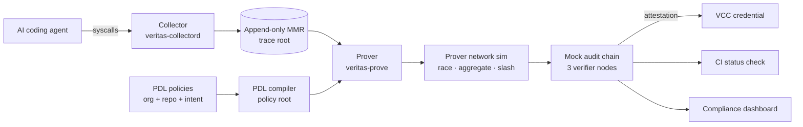

# 🏗 Architecture — Veritas Protocol

> Part of [veritas-protocol-ai-agents](https://github.com/shiroonigami23-ui/veritas-protocol-ai-agents). Back to the [README](../README.md).

## 1. System Overview

Veritas separates *what happened* (the trace), *what was allowed* (the policy) and *who vouches for it* (the chain).
The collector turns raw agent activity into canonical events committed to an append-only MMR, yielding a trace root.
PDL policies compile to a policy root. The prover consumes both roots plus the events and outputs a proof; a simulated
prover network races, aggregates and slashes; verifier nodes on the mock chain attest; downstream tools (VCC, CI,
dashboard) consume the attested bundle. See also `docs/architecture/overview.md`.

## 2. Components

| Component | Location | Responsibility |
|---|---|---|
| **Core** | `src/veritas/core/` | Trace model, commitments, PDL, policy engine, prover logic |
| **Collector** | `src/veritas/collector/` | Event canonicalisation, write dedup, MMR append/get_proof/finalize |
| **Prover network** | `src/veritas/prover_network/` | Mempool race, recursive aggregation, cut-and-choose slashing |
| **Mock chain** | `src/veritas/mock_chain/` | 3 verifier nodes, verify_and_attest, anchoring |
| **Compliance** | `src/veritas/compliance/` | VCC selective-disclosure build/verify |
| **CI & dashboard** | `src/veritas/ci/, src/veritas/dashboard/` | Status-check and snapshot generators |
| **CLI** | `src/veritas/cli/` | Nine console entry points declared in pyproject.toml |

## 3. Data / Control Flow

1. The collector ingests a session trace and emits canonical events, collapsing repeated writes to final intent.
2. Events are appended to the MMR; finalising yields the trace root and inclusion proofs.
3. Policies are parsed, composed (org → repo → intent) and compiled to deterministic constraints + policy root.
4. The prover evaluates every event against the constraints and produces a proof bundle bound to both roots.
5. The mock chain's verifier nodes re-check the bundle and sign an attestation (optionally anchoring it).
6. VCC, CI-status and dashboard tools derive their outputs from the attested bundle.

## 4. Key Design Decisions

| Decision | Rationale |
|---|---|
| MMR for traces | Append-only, streaming-friendly and supports compact inclusion proofs |
| Deterministic PDL compilation | Identical policy text ⇒ identical root, so policies can be referenced by hash |
| Simulated prover network first | Validate incentives and protocol flow before investing in real zk proofs |
| Requirement IDs in code & tests | Keeps the prototype auditable against the blueprint |

## 5. Known Limitations

- Proofs are an abstraction, not zero-knowledge proofs yet
- Collector replays recorded traces rather than capturing live syscalls
- The audit chain is an in-process mock

---
*Last updated: 2026-11-13*
